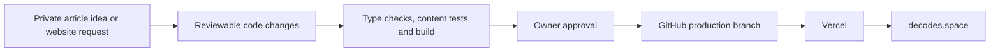

# DeCodes Life

**A personal publishing and portfolio website connecting finance, applied AI,
career development and lived experience.**

[Visit the website](https://decodes.space) ·
[Build journal](blog-finance-hub/docs/build-journal.md) ·
[Cloud publishing workflow](blog-finance-hub/docs/cloud-workflow.md)

This repository contains the actual application source, not just a project
description. The app lives in [`blog-finance-hub/`](blog-finance-hub/).
This README is the introduction GitHub displays to help visitors understand it.

## What this project demonstrates

- **Taking ownership of an AI-assisted starting point.** The original site came
  from Manus; subsequent work adapted it into a GitHub-managed website with a
  Vercel publishing workflow.
- **Building an editorial system.** Articles use typed React content, descriptive
  URLs, metadata, related-post links, a sitemap, RSS and prerendered pages.
- **Developing a portfolio experience.** The site combines finance case studies,
  applied-AI project pages, a learning-progress section and professional context.
- **Iterating on interface design.** Commit history documents mobile reading
  layouts, bamboo and floral visuals, navigation, animation and loading behavior.
- **Learning through deployment failures.** A sequence of lockfile and pnpm
  configuration fixes records the work needed to restore a reproducible build.

This is an evolving personal project built with AI assistance. The history
records changes and decisions; it should not be read as a claim that every
component was hand-written or that every included backend feature is deployed.

## Architecture



The planned Codex Cloud workflow moves preparation and testing off a particular
laptop. Its setup instructions are included here; environment access and a
cross-device trial must be verified separately.

| Area | Implementation |
| --- | --- |
| Interface | React 19, TypeScript, Vite, Tailwind CSS, Wouter |
| Articles | React/JSX entries in `client/src/data/posts.tsx` |
| Discovery | Related links, sitemap, generated RSS and article prerendering |
| Checks | TypeScript and Vitest |
| Hosting workflow | GitHub commits and Vercel deployment |
| Included backend | Express, tRPC, Drizzle/MySQL and service integrations |

The repository includes backend code inherited from the broader application.
Its presence does not establish that those endpoints are running on the public
site. The frontend can be built without production credentials.

## Explore the code

```text
blog-finance-hub/
  client/src/
    components/        Navigation, shared UI and visual behavior
    contexts/          Theme state
    data/              Articles and related-post links
    pages/             Blog, portfolio and project pages
  client/public/       Images, sitemap, RSS and public assets
  scripts/             RSS generation and article prerendering
  server/              Backend routes and tests
  drizzle/             Database schema and migrations
  docs/                Publishing instructions and build journal
```

## Run locally or in a cloud workspace

Use a current Node 24 release and the package-manager version declared by the
project, **pnpm 10.4.1**. From a clone:

```sh
cd blog-finance-hub
corepack enable
corepack pnpm install --frozen-lockfile
corepack pnpm check
corepack pnpm test -- server/blog-posts.test.ts client/src/data/relatedPosts.test.ts
corepack pnpm run build
corepack pnpm exec vite preview --host 127.0.0.1
```

For frontend development, use `corepack pnpm exec vite --host 127.0.0.1`.
`pnpm dev` starts the broader server application and requires its own service
configuration for service-dependent features. Never copy production secrets
into source code or frontend environment variables.

## Publishing and collaboration

Brainstorm privately, prepare a change, review the exact content and test
results, then approve publication. A public branch or pull request also makes
its contents public; unpublished drafts belong outside this repository.

Start with the [publishing guide](blog-finance-hub/docs/publishing-workflow.md)
or [cloud workflow](blog-finance-hub/docs/cloud-workflow.md). Existing articles
and hosting should be preserved when making unrelated changes.

## Security and project limits

See [SECURITY.md](SECURITY.md). Public source code is intentional; credentials,
private drafts, diagnostic logs and database contents are not.
Repository visibility is not a substitute for dependency maintenance,
authorization checks or safe deployment configuration.

This project is under active review. Do not assume the included backend is
production-hardened, and do not deploy it with real customer data without
reviewing its authentication, uploads, email routes and dependencies.
