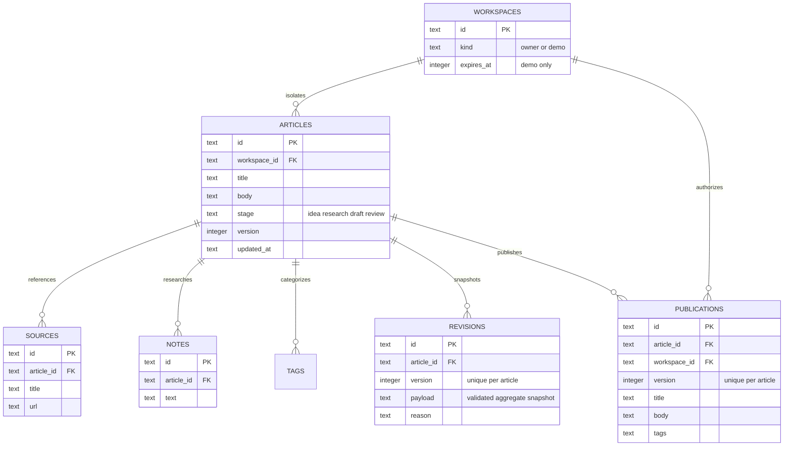

# Decode’s Studio — a local full-stack vertical slice

Studio lives at `/studio`. It is a **research and publishing sandbox**, not a replacement for the live blog’s approval/GitHub/Vercel process. The earlier Company Risk Explorer work remains local and unchanged by this project except for shared route/portfolio integration.

## What works / what is not connected

Implemented: create an article, attach sources and private notes, edit with autosave and explicit save status, recover revisions, reject stale writes, preview, validate, confirm publication, read a separate immutable Studio snapshot, and search/paginate a workspace archive.

Visitor mode: a random HttpOnly cookie identifies an isolated SQLite workspace. A fictional idea/research/draft history is seeded when it begins. It expires in 24 hours, is not a real writing backup, and cannot reach owner records. A new browser has a separate workspace. “Published” snapshots still require access to that workspace; they are **not publicly shared permalinks**. This is deliberate for a demo containing arbitrary visitor writing.

Owner mode: backend authentication uses the existing site's `sdk.authenticateRequest`; authorization compares its authenticated `openId` with the nonempty configured `OWNER_OPEN_ID` on **every request**. There is no development login bypass, user-supplied owner flag, or “admin” selector. Missing owner configuration returns 503; missing authentication 401; another identity 403. The current environment has no owner/OAuth/database/JWT configuration, so a real owner login cannot yet be demonstrated. Tests exercise the authorization boundary with an injected test authenticator; production uses only the existing SDK.

The current Vercel site is static. Production Studio API registration is **off by default** unless `STUDIO_ENABLED=true`. No hosting configuration, account grant, secrets, deployment or live article files were changed. Enabling a real remote owner workspace requires a separate approved plan for durable storage, supported authentication, backups, HTTPS, abuse controls and deployment. A SQLite file on ephemeral/serverless disk is not adequate for real cross-device drafts. Do not set the production flag as a shortcut around that decision.

## Run the local demo

Node **24** is required for built-in SQLite; pnpm **10.4.1** is the repository's pinned manager. No npm dependency was added. The repository already has Express, React, Zod, existing auth code, and a Node server build.

From `blog-finance-hub/`:

```sh
pnpm install --frozen-lockfile
pnpm dev
```

Use the configured local origin `http://localhost:3000`, then `/studio`. The existing CORS list permits `localhost`, not an interchangeable `127.0.0.1` frontend origin. Do not weaken CORS to make an unrelated origin work.

If the environment blocks the watcher's IPC socket, the same server can run without watching:

```sh
NODE_ENV=development node --import tsx server/_core/index.ts
```

Binding a local HTTP port may require the environment's supported execution permission. Do not bypass its network controls. The OAuth module logs a missing-configuration message when no provider is set; the visitor demo still works. Do not use the demo for confidential personal drafts.

The SQLite file defaults to `.cache/studio/studio.sqlite` (ignored). `STUDIO_DB_PATH` can select another local durable file. Node creates the parent directory with mode 0700. WAL mode, foreign keys, and a busy timeout are enabled. Restarting the Node process with the same file retains data; deleting the file removes it. Keep a private backup before any schema work. This first slice uses `CREATE TABLE IF NOT EXISTS`; production schema migration/versioning is a future requirement.

## Data model



Source/note records are related rows in the live draft. A revision stores a complete validated aggregate as JSON so restoring content, sources and notes stays coherent. Related rows are replaced within the same transaction on each save. The browser never chooses workspace IDs. Article IDs are scoped by the server-derived workspace on all record reads and writes.

## An edit’s path through the system

1. React updates the editor immediately. The status becomes “Unsaved changes.” No body text is put in localStorage.
2. After 900 ms of quiet, the editor validates the aggregate and sends `PUT /api/studio/:mode/articles/:id` with `expectedVersion`.
3. Same-origin mutation checks and request/rate limits run. Owner identity or a demo session derives the workspace. Zod validates content and limits; source URLs must use HTTPS. The server never fetches these URLs.
4. SQLite starts `BEGIN IMMEDIATE`, loads the scoped record, and compares its version. A mismatch returns **409 without writing**.
5. A valid save updates the article, replaces related source/note/tag rows, and appends a revision atomically, then commits.
6. The server returns the new version. The UI shows “Saved.” If the visitor typed during the request, a serialized next save sends the newest text against the newly returned version.
7. On failure or conflict, text remains in the editor. Retry is explicit after failure. A conflict requires downloading/copying the current draft or loading the server version with confirmation; the UI never silently overwrites the newer server version. A lost response after a successful server write can produce a conflict on retry: this is intentional rather than pretending the save never happened.

The UI warns before leaving with unsaved text. It does not promise recovery after a browser/process crash before autosave. “Download draft” is a safety copy, not a cross-device import feature or automatic backup.

## Publication boundary

Preview renders plain text as escaped paragraphs; no user HTML/JS is executed. Server publication validation requires a title, sufficient text, one source, the Review stage, the exact current version, and explicit confirmation. Validation is structural, **not fact-checking, plagiarism checking, or editorial approval**.

Publication copies title, body and tags into a separate immutable record. It does not include private notes or source-panel records. If citations should be visible, write them into the article text; rich linked citations/Markdown are not implemented in this first slice. This limitation is explained before confirmation. The source-panel publication policy should be reconsidered with De before connecting real articles.

Later draft edits and restored revisions cannot alter an older published record. Republishing a new version creates another snapshot; repeated publication of the same version is idempotent. A different demo session or non-owner cannot read it. API responses use `Cache-Control: no-store`; Studio pages are noindex. No operation writes `posts.tsx`, sitemap/RSS, GitHub, or Vercel.

## Archive and limits

Title/body search, exact tag filtering, a “has published snapshot” filter, and five results per page are SQL queries scoped to the current workspace. `%` and `_` in a search are literals, not wildcard shortcuts. Published-filter results still show the **current workspace draft metadata**, not a public reader archive; published text is read only via its snapshot endpoint.

Limits: 20 articles per workspace, 80,000 body characters, 20 sources, 30 notes, 10 tags, 256 KB requests; 180 requests/minute/IP and 20 new demo sessions/15 minutes/IP. Expired demo workspaces are deleted on subsequent requests. Latest 100 revisions are listed; older records are retained. This is not enough abuse/storage planning for an unrestricted public service. No collaborative cursors, rich-text execution, images, source scraping, cross-device demo sync, real-time shared review or live-blog deployment is claimed.

## Decision log — evidence, not invented user research

| Decision | Options considered | Chosen approach and tradeoff | Actual verification/observation |
| --- | --- | --- | --- |
| Evidence beside writing | Separate tab; side panel | Side panel on desktop; stacked on phone | Browser screenshots showed the long editor pushes research below the phone fold. Added keyboard-focus jump controls to sources and back to article, instead of making the reader scroll the entire editor repeatedly. This is an implementation observation, not a user study. |
| Storage for the first slice | Existing MySQL with missing credentials; local file JSON; SQLite | Node 24 SQLite, no npm dependency; related tables and transactions | HTTP tests reopen the same database and verify sources/notes/revisions survive. Real deployment still needs durable hosting and configured owner authentication. |
| Save conflicts | Last-write-wins; explicit version check | Version check plus recoverable snapshots | Two competing saves: one success, one 409. Browser conflict test confirms the unsaved editor text remains downloadable. |
| Publication | Read directly from current draft; immutable copy | Separate publication snapshot | Edit draft after publishing; snapshot stays unchanged and excludes research notes. |
| Demo access | Global shared sample; isolated session | Random token in HttpOnly SameSite=Strict cookie; SHA-256 token digest scopes rows; 24h expiry | Separate browser/session receives 404/401 for another sample and its published page. No client owner flag is trusted. |
| Existing watch command | Change application scripts; use Node loader | Reuse `pnpm dev`; document non-watch `node --import tsx` fallback | Watcher IPC denied in this sandbox. Direct Node startup worked once loopback execution was permitted. Existing CORS required the configured localhost origin. |

No performance statistics, user interviews or personal learning outcomes have been invented. De’s observations belong in the blank test log below after she tries it.

## Case study: user, workflow and validation

**User/decision:** A writer wants to develop an evidence-backed article without losing work or accidentally changing public content.

**Before:** The site's posts live directly in React code. Drafting/research can occur in chats or local documents, with publication controlled by GitHub/Vercel and explicit user approval. Studio does not replace that working process yet.

**After in this sandbox:** The writer moves one article from idea through research/draft/review, with nearby sources, explicit save state, revision recovery and a separately published snapshot. The database and authorization boundaries are demonstrated locally.

**What I built:** An editorial React workspace, isolated Express API, relational SQLite persistence, versioned save/restore, and explicit publication snapshots using the existing codebase. The research panel adapts for phone use.

**How I checked it:** HTTP integration tests validate exact-owner authorization, session isolation and expiry, origin/input rejection, persistence after reopening the database, concurrent saves, restore conflicts, immutable publications, private-note exclusion, search filters and pagination. Browser tests exercise autosave, simulated save failure, concurrent-tab conflict, draft download/recovery, restoration, publish validation and confirmation, published snapshot separation, archive empty state, themes and phone navigation.

**What remains limited:** Actual owner provider login is not configured or verified here. Real cross-device persistent writing needs an approved production backend/storage/auth plan. Public live-blog connection is intentionally absent. Demo publishing is private to the session; public shared demo pages would require a separate explicit content/moderation policy. Existing full-site CSS/auth infrastructure has its own limitations outside this slice.

## Tests

```sh
pnpm check
pnpm exec vitest run server/studio.test.ts
```

Also run the exact CI selection plus the existing/new project tests, production build, and audit. CI includes a separate Studio HTTP test step. Node 24’s SQLite API is experimental on this runtime; the version is pinned. A native `createRequire` loads it to avoid the old Vitest resolver misclassifying the new builtin. The SQL/HTTP tests run against the real native database, not a storage mock.

## De’s hands-on test script — observations pending

1. Open Studio in the running local app and start a **new visitor demo**. Read the fictional-data notice.
2. Rename the sample, write a paragraph and watch Unsaved → Saving → Saved.
3. Add a source and note. Check whether keeping them beside the draft helps or distracts you. On a phone, try both jump controls.
4. Open Revision history, compare a previous version, restore it. Confirm a new version appears and the old one remains.
5. Preview while the stage is Draft. Check the validation message. Move to Review, wait for Saved, then confirm sandbox publication.
6. Open the published snapshot. Return to the editor and change the draft. Confirm the snapshot stays unchanged.
7. Try a separate browser/private window: it must not show the first session’s draft or publication.
8. Search/filter the archive. Try no results. Download an unsaved draft as a backup before closing the demo.

Record actual results here (do not fill them in for De):
- Task/date/device:
- Where I hesitated:
- What I expected:
- What happened:
- Design change I would make:
- What I personally learned:
